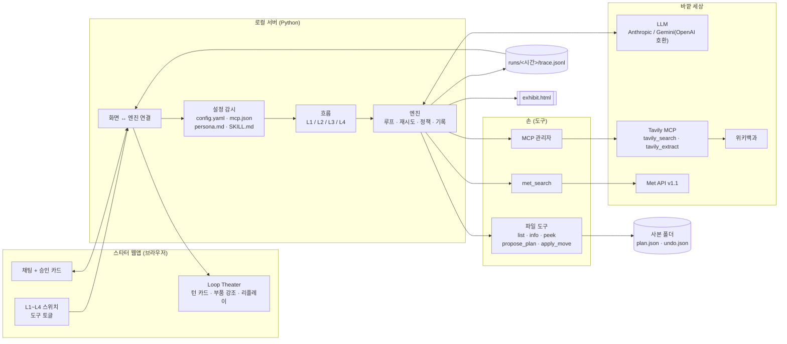
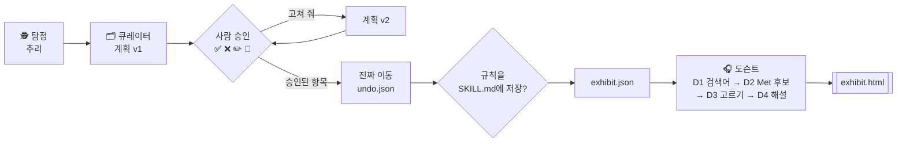
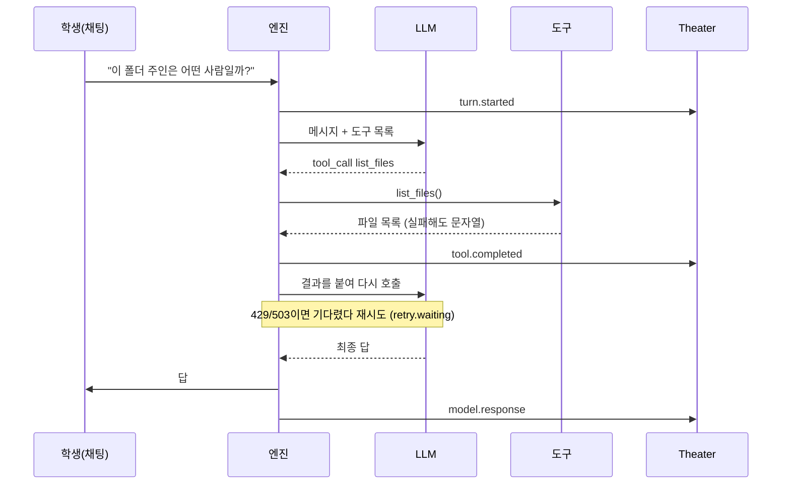

# 04. 구조: 모듈, 에이전트, 도구, 데이터 흐름

> 현재 공통 실습: 샘플은 사본 없이 저장소의 `sample_downloads/`에서 직접 사용합니다. **폴더 고르기 → 샘플 폴더 → 이 폴더 사용**으로 선택하며, 이동 결과·노트·갤러리도 같은 폴더에서 확인합니다. 아래 초기 설계의 사본 절차는 개인 폴더 사용에만 해당합니다. 현재 실행 안내는 [GUIDE 0-6](../GUIDE.md#0-6-화면과-실습-폴더)을 따릅니다.

> 처음 보는 말(에이전트, 루프, 도구, MCP, 스킬, API, 하네스 등)은 [용어 풀이](00_glossary.md)에 쉬운 예시와 함께 있습니다.
> 모듈 = 키트를 이루는 부품 하나하나(파일이나 폴더). 데이터 흐름 = 정보가 어디서 어디로 가는지.

> 아직 만들지 않은 키트의 **목표 구조**입니다. 이름은 제안이고, 원칙(학생은 부품만 바꾸고 엔진은 건드리지 않음)은 지킵니다.

## 1. 큰 그림



## 2. 모듈

| 모듈 | 하는 일 | 학생이 고치나 | 관련 요구사항 |
|---|---|---|---|
| `app/server.py` | 노트북 안에서 도는 작은 서버. 엔진 소식을 화면에 실시간으로 보내고, 승인 버튼 결과를 받음 | 아니오 | APP, THR-01 |
| `app/web/` | 채팅, Theater, 스위치 화면(빌드 없는 HTML/JS, 로컬 자산) | 아니오(Cursor로 꾸미기는 가능) | APP, THR |
| `engine/loop.py` | aisuite 호출, 턴 한도, 도구 실행 | 아니오 | ENG-01, 02 |
| `engine/safe_tool.py` | 도구 감싸개: 예외 → `"error: ..."` 문자열 | 아니오 | ENG-03 |
| `engine/retry.py` | 429/503 대기와 재시도, `retry.waiting` 이벤트 | 아니오 | ENG-04 |
| `engine/policy.py` | `require_approval` 도구를 승인 대기로 보냄 | 아니오 | HIL-06 |
| `engine/skills.py` | 스킬 목록 주입, `load_skill` 도구 | 아니오 | ENG-06 |
| `engine/mcp.py` | `mcp.json` 읽기, 연결, 도구 허용 목록, 실패 허용 | 아니오 | ENG-07, 08 |
| `engine/trace.py` | `trace.jsonl` 기록(키 가림) | 아니오 | ENG-09 |
| `engine/flows.py` | L1~L4 흐름 정의와 `graph.node.entered` 이벤트 | 아니오 | LV, ENG-11 |
| `engine/config.py` | 설정 읽기·쓰기, 파일 감시 | 아니오 | APP-06 |
| `tools/files.py` | 읽기 도구 3개 | 아니오 | FS-05 |
| `tools/plan.py` | `propose_plan`, `apply_move`(승인 필요), 되돌리기 | 아니오 | FS-06~11 |
| `tools/met.py` | Met 검색, 공공 도메인 필터, 캐시 | 아니오 | MET |
| `tools/time.py` | `get_time` (장면 0→2 뒤집기용) | 아니오 | LV-01 |
| `agents/*/persona.md` | 탐정·큐레이터·도슨트 말투 | **예** | ENG-05 |
| `skills/*/SKILL.md` | 일하는 법 | **예** | ENG-06 |
| `config.yaml`, `mcp.json` | 단계, 도구, 모델, MCP | **예**(버튼으로도) | 5장 |
| `render/exhibit_template.html` | 갤러리 모양 | **예**(Cursor로) | REN-03 |
| `scripts/make_sandbox.py`, `scripts/undo.py` | 사본 만들기, 되돌리기 | 아니오 | FS-01~04, 11 |

## 3. 에이전트

| 에이전트 | 단계 | 페르소나 | 쓰는 도구 | 넘겨주는 것 |
|---|---|---|---|---|
| (챗봇) | L1 | 기본 | 없음 | — |
| (고정 흐름) | L2 | 기본 | 코드가 순서대로 `list_files` → `count_by_type` → LLM 요약 | 보고서 |
| 🕵️ 탐정 | L3 | `agents/detective/persona.md` | `list_files`, `file_info`, `peek_file`, `get_time`, `tavily_search` | 폴더 주인 추리 |
| 🗂️ 큐레이터 | L3 | `agents/curator/persona.md` | 읽기 도구, `load_skill`, `propose_plan`, `apply_move`(승인), `save_skill_rule`(승인) | `exhibit.json` |
| 🎧 도슨트 | L4 | `agents/docent/persona.md` | `met_search`, `tavily_extract`, (선택) 비전 | `exhibit.json`에 작품·해설 추가 |

L4 흐름(코드가 넘겨줌):



## 4. 도구 목록

| 도구 | 종류 | 읽기/쓰기 | 승인 | 실패 시 돌려주는 값 (예) |
|---|---|---|---|---|
| `get_time` | 직접 만든 도구 | 읽기 | 없음 | — |
| `list_files` | 직접 만든 도구 | 읽기 | 없음 | `error: 폴더 없음` |
| `file_info(path)` | 직접 만든 도구 | 읽기 | 없음 | `error: not found (call list_files again)` |
| `peek_file(path)` | 직접 만든 도구 | 읽기 (앞 500자) | 없음 | `error: 읽을 수 없는 형식` |
| `count_by_type` | 직접 만든 도구 (L2) | 읽기 | 없음 | — |
| `load_skill(name)` | 엔진 도구 | 읽기 | 없음 | `error: 스킬 없음` |
| `propose_plan(items)` | 직접 만든 도구 | `plan.json`만 씀 | 없음 | `error: 형식 오류` |
| `apply_move(plan_id, items)` | 직접 만든 도구 | **쓰기**(이동·이름 변경) | **필요** | `error: 사본 폴더 밖` / `denied by user` |
| `save_skill_rule(text)` | 엔진 도구 | **쓰기**(`SKILL.md`) | **필요** | `denied by user` |
| `met_search(q)` | 직접 만든 도구 | 외부 읽기 | 없음 | `error: Met API 응답 없음 (캐시 사용)` |
| `tavily_search` | MCP (Tavily) | 외부 읽기 | 없음 | MCP 오류 문자열 |
| `tavily_extract` | MCP (Tavily) | 외부 읽기 | 없음 | MCP 오류 문자열 |
| 파일 삭제 | — | — | — | **만들지 않음** |

## 5. MCP

| 서버 | 기본 | 실행 | 키 | 용도 |
|---|---|---|---|---|
| Tavily (`tavily-mcp`) | **켬** | `npx -y tavily-mcp@latest` | 선택(`TAVILY_API_KEY`) | 웹 검색과 읽기 |
| Filesystem (`@modelcontextprotocol/server-filesystem`) | 끔 | `npx` | 없음 | 선택. "남이 만든 손" 추가 예시 |
| DuckDuckGo MCP | 끔 | — | 없음 | Tavily 예비. 불안정 |
| Playwright MCP | 학생 키트에 없음 | 강사 PC | 없음 | 강사 시연 |

## 6. 한 번의 턴 (L3)



## 7. 키트 폴더 구조 (목표)

```
agent-kit/                         (수업용 키트, 다음 단계에서 개발)
├─ README.md                       설치 3단계 + 문제 해결 (Mac/Windows 나란히)
├─ pyproject.toml, uv.lock         aisuite==0.2.0 등 버전 고정
├─ .env.example                    키 이름만
├─ .gitignore                      .env, runs/, data/, exhibit_copy/
├─ config.yaml                     ← 학생/버튼이 바꿈
├─ mcp.json                        ← 학생/버튼이 바꿈
├─ app.py                          uv run app.py
├─ app/
│  ├─ server.py
│  └─ web/  index.html · app.js · theater.js · style.css · vendor/(mermaid 등 로컬)
├─ engine/  loop.py · safe_tool.py · retry.py · policy.py · skills.py · mcp.py · trace.py · flows.py · config.py
├─ tools/   files.py · plan.py · met.py · time.py
├─ agents/
│  ├─ detective/persona.md         ← 학생이 바꿈
│  ├─ curator/persona.md           ← 학생이 바꿈
│  └─ docent/persona.md            ← 학생이 바꿈
├─ skills/
│  └─ curator/SKILL.md             ← 학생이 바꿈 (빈칸 템플릿)
├─ levels/
│  ├─ L1/mission.md   L1_done/
│  ├─ L2/mission.md   L2_done/
│  ├─ L3/mission.md   L3_done/
│  └─ L4/mission.md   L4_done/
├─ render/  exhibit.py · exhibit_template.html   ← 템플릿은 학생이 바꿈
├─ scripts/ make_sandbox.py · undo.py · warm_cache.py (Met 캐시, npx 미리 받기)
├─ sample_downloads/               가상 학생의 엉망 다운로드 40개
├─ replays/ L1.jsonl … L4.jsonl    강사 녹화본 (오프라인 대비)
├─ data/    met_cache.json         (gitignore)
├─ runs/                           실행 기록 (gitignore)
├─ storyboard/ template_A3.pdf · prompt.md · extract.py(COULD)
├─ print/   cards.pdf (3색 카드, 다이얼 스티커)
└─ .cursor/rules/workshop.mdc      엔진 수정 금지, 삭제 기능 금지, Met v1.1
```

## 8. 3~4시간차에 바꾸는 부품

| 부품 | 공통 에이전트의 기본값 | 바꾸는 예 |
|---|---|---|
| 대상 폴더 | 다운로드 사본 | 레퍼런스 이미지 폴더, 강의 노트 폴더 |
| 페르소나 | 탐정·큐레이터·도슨트 | 깐깐한 편집장, 다정한 사서 |
| 스킬 | 큐레이터 이름 규칙 | 레퍼런스에 태그 붙이는 법, 노트 요약하는 법 |
| 연결 서비스 | Met API, Tavily | 날씨 API, 다른 미술관 API, 직접 만든 MCP |
| 승인 지점 | 파일 이동 | 밖으로 보내기 전 승인, 저장 전 승인 |
| 자율성 단계 | L1~L4 | 내 기획에 맞는 단계 |
| 결과 화면 | 갤러리 HTML | 카드 모음, 포스터 한 장 |

## 9. 일반 모델: 대부분의 에이전트가 가진 구조

많은 "나만의 에이전트" 아이디어는 이 한 문장으로 줄일 수 있습니다.

> 사용자가 **무언가를 남기면**(말·글·사진·소리·파일) → 캐릭터가 그것을 **해석해서** → 어딘가에 **쌓고** → **보기 좋게 다시 보여 준다.**

여기에 "갈림길(분기)"이 강하면 그래프형, "역할 나누기"가 강하면 멀티에이전트형이 됩니다.

부품(슬롯) 9개:

| # | 부품 | 하는 일 | 이 키트에서 |
|---|---|---|---|
| ① | 감각 | 입력을 AI가 읽을 수 있게 바꿈 | 파일 이름·크기·앞부분 |
| ② | 페르소나 | 캐릭터, 말투, 금지 사항 | `persona.md` |
| ③ | 루프 | 고르기 → 해 보기 → 결과 보기 → 반복 | 엔진 |
| ④ | 스킬 | 필요할 때만 읽는 업무 매뉴얼 | `SKILL.md` |
| ⑤ | 도구 / MCP | 세상을 만지는 손 | 파일 도구, Met API, Tavily |
| ⑥ | 기록·기억 | 쌓이는 것, 다음에도 기억할 것 | 사본 폴더, `plan.json`, `SKILL.md`의 배운 규칙 |
| ⑦ | 흐름(그래프) | 정해진 길과 갈림길 | L2 고정 흐름, 장면 5 흐름 |
| ⑧ | 정책 | 승인, 안전, 턴 한도 | `require_approval`, `max_turns` |
| ⑨ | 결과 화면 | 보여 주는 방식 | `exhibit.html` |

"에이전트"라고 부르려면 최소한 이것이 있어야 합니다.

| 필수 | 부품 | 확인 방법 |
|---|---|---|
| 1 | ③ 루프 | 한 요청에서 도구 호출이 2회 이상 이어지고, 턴 한도에서 멈춘다 |
| 2 | ⑤ 도구 1개 이상 | 도구 결과가 다음 판단을 바꾼다 |
| 3 | ⑥ 기록 | 다시 실행해도 결과가 남아 있다 |
| 4 | ② 페르소나 + ⑨ 결과 화면 | 파일만 바꿔도 말투가 바뀌고, 결과가 화면으로 보인다 |

**바꾸지 않는 것**: 엔진(루프, 기록, 스킬 불러오기, 도구 등록). 학생은 "엔진"이 아니라 "부품"만 바꿉니다.
